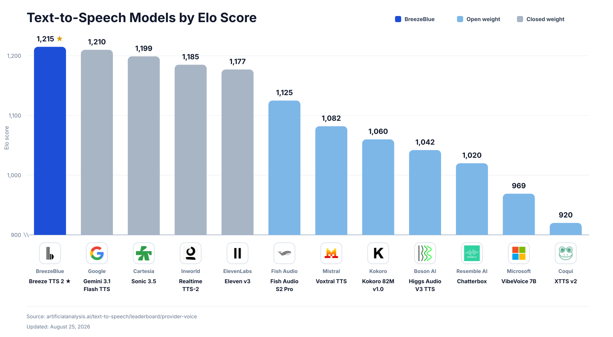

<div align="center">
  <h1>❗纯 AI 产物，有需求建议去原版仓库</h1>
  <p><b>本仓库是 <a href="https://github.com/breezeblue-ai/breeze-tts">breezeblue-ai/breeze-tts</a> 的第三方本地化分支，
  仅额外增加网页控制台与音色库（<code>webui/</code>），上游代码未作修改。<br>
  功能建议、问题反馈与模型相关的疑问，请优先前往原版仓库或 <a href="https://huggingface.co/BreezeBlue/breeze-tts-2">官方模型页</a>；
  模型权重不随本仓库分发。</b></p>
  <br>
  <a href="https://breezeblue.ai/"></a>
  <br><br>
  <a href="https://huggingface.co/BreezeBlue/breeze-tts-2"></a>
  <a href="https://breezeblue.ai/breeze-tts-2"></a>
  <a href="https://breezeblue.ai/"></a>
  <a href="https://discord.com/invite/6H7AgPe9pA"></a>
  <a href="https://x.com/BreezeBlueX"></a>
  <br><br>
  <b>中文 | <a href="README.en.md">English</a></b>
</div>

> [!IMPORTANT]
> 源码采用 Apache 2.0 许可。Breeze TTS 2 的模型权重、衍生模型与自托管输出**仅限研究与非商业用途**，详见[许可证与负责任使用](#许可证与负责任使用)。

> [!TIP]
> 想直接用网页操作，看 **[WEBUI.md](WEBUI.md)**；想了解本分支新增了什么、Windows 上怎么跑通，本文第 2 节有一份速查。

## 📰 动态

- **[2026.08.25]** 🎉 发布 [Breeze TTS 2](https://huggingface.co/BreezeBlue/breeze-tts-2) 模型权重与 [PyTorch 推理代码](https://github.com/breezeblue-ai/breeze-tts)。
- **[2026.08.07]** 🔥 发布 TTS 评测套件：[声音设计](https://github.com/breezeblue-ai/tts-voice-design-benchmark)、[声音导演](https://github.com/breezeblue-ai/TTS-Voice-Direction-Benchmark)、[延迟评测](https://github.com/breezeblue-ai/TTS-Latency-Benchmark)。

## 📖 简介

Breeze TTS 2 是一个面向实时交互场景的开放权重文本转语音模型。它在 Artificial Analysis 的 TTS 榜单上位列开源模型第一，并超过多家前沿闭源系统。模型具备开放式自然语言指令跟随能力，因此既能「无参考音频、用文字造音色」，也能「给参考音频、用文字导演演绎方式」；同时凭借极低延迟的流式生成，支撑自然、富有表现力的实时对话。

<div align="center">
  
</div>

## ✨ 特性

- 🎙️ **声音克隆** —— 给定参考音频与它的**逐字文字稿**，保留音色、节奏、情绪与说话风格。
- 🎨 **声音设计** —— 不需要参考音频，仅用一段自然语言描述创造全新音色。
- 🎛️ **声音导演** —— 用参考音频锁定音色身份，再用文字控制语气、情绪、语速与演绎方式。
- 🎭 **副语言事件** —— 直接在文本里插入表现力事件：英文用圆括号，如 `(laugh)`、`(cough)`、`(clears throat)`、`(sigh)`；中文用方括号，如 `[笑]`、`[咳嗽]`、`[清嗓子]`、`[叹气]`。
- ⚡ **极低延迟** —— 在 NVIDIA H100 上走预热好的快速路径，首包延迟（TTFA）低于 40 ms。
- 🌊 **实时流式** —— 在 H100 快速路径下实时率（RTF）达 0.32，约为实时的 3.1 倍速生成。
- 💾 **显存友好** —— eager 推理约需 7.7 GiB 显存，推荐最低 12 GB 显卡。
- 🌏 **中英双语** —— 单一模型即可生成自然的中文与英文语音。

## 🚀 快速开始

### 环境要求

- Linux 与 Python 3.10 或更高版本
- 一块支持 CUDA 的 NVIDIA 显卡
- 显存：eager 推理约 7.7 GiB，开启 `--fast-all` 需 14.4 GiB；即 eager 用 12 GB 显卡、快速路径用 24 GB 显卡
- Breeze TTS 2 的检查点（权重）

### 安装

获取推理代码：

```bash
git clone https://github.com/breezeblue-ai/breeze-tts.git
cd breeze-tts
```

安装依赖：

```bash
python -m pip install -r requirements.txt
```

所需的模型组件全部包含在 Breeze TTS 2 的检查点里，无需额外下载其他权重。

如需复现官方测试过的 CUDA 环境，可以构建仓库自带的 Docker 镜像：

```bash
bash docker/build.sh
```

默认镜像面向 H100/Hopper（sm90）。若使用 A100：

```bash
FLASH_ATTN_CUDA_ARCHS=80 bash docker/build.sh
```

### 🎙️ 声音克隆

用干净的参考音频和它的逐字文字稿克隆说话人。

#### 英文

```bash
python infer.py ../breeze-tts-2 \
  --ref-audio reference_en.wav \
  --ref-text "This is the exact transcript of the English reference audio." \
  --text "(sigh) It is good to hear your voice again after all this time." \
  --output outputs/voice_clone_en.wav
```

#### 中文

```bash
python infer.py ../breeze-tts-2 \
  --ref-audio reference_zh.wav \
  --ref-text "这是中文参考音频的准确文字稿。" \
  --text "[叹气] 没想到过了这么久，你还记得我的声音。" \
  --output outputs/voice_clone_zh.wav
```

参考音频应当是干净、无循环重复的语音，背景噪声尽量小。`--ref-text` 必须覆盖参考音频**完整的口播内容**；如果音频里有重复的语句，文字稿也要如实包含这些重复。声音克隆不使用指令；一旦加了 `--instruction`，就切换成「声音导演」模式。

> ⚠️ **本分支实测的重要限制**：纯克隆（有参考音频、无指令）**必须使用 `cfg_scale=1`**。上游只有「带指令的模板」才定义了 negative prompt，纯克隆模板没有，此时 `cfg_scale>1` 会直接报 500：
> `Template 'ref_clone_tata' does not define a negative prompt but cfg_scale=4.0`。
> 本仓库的网页控制台已自动处理该情况（描述留空时 CFG 锁定为 1.0）。

### 🎨 声音设计

不需要参考音频，用自然语言描述即可创造音色。**描述语言要与目标文本语言一致**；用 `--cfg-scale 4` 可以强化对描述的遵循程度。

#### 英文

```bash
python infer.py ../breeze-tts-2 \
  --text "(sigh) Welcome aboard. Your journey begins now." \
  --instruction "A warm, thoughtful young woman with a clear voice and a calm, reflective delivery." \
  --cfg-scale 4 \
  --output outputs/voice_design_en.wav
```

#### 中文

```bash
python infer.py ../breeze-tts-2 \
  --text "[笑] 欢迎来到今晚的故事时间，让我们一起开始吧。" \
  --instruction "一位温柔自信的年轻女性，声音清晰，语气亲切，表达轻快而富有感染力。" \
  --cfg-scale 4 \
  --output outputs/voice_design_zh.wav
```

### 🎛️ 声音导演

保持参考说话人的身份不变，同时用文字指挥语气、情绪、语速与演绎方式。用 `--cfg-scale 4` 强化指令跟随。

```bash
python infer.py ../breeze-tts-2 \
  --ref-audio reference.wav \
  --ref-text "This is the exact transcript of the reference audio." \
  --text "(clears throat) We need to discuss what happened last night." \
  --instruction "Speak slowly with a restrained, serious tone." \
  --cfg-scale 4 \
  --output outputs/voice_direction.wav
```

### 🌐 流式 API

启动单并发流式 API。它复用同一套 PyTorch 运行时，默认走 eager 执行：

```bash
python -m breeze_infer.api ../breeze-tts-2 --host 0.0.0.0 --port 7860
```

发送一个带参考音频、CFG 为 4 的声音导演请求：

```bash
curl -X POST http://127.0.0.1:7860/v1/audio/speech \
  -F "cfg_scale=4" \
  -F "ref_audio=@reference.wav" \
  -F "ref_text=This is the exact transcript of the reference audio." \
  -F "text=(clears throat) We need to discuss what happened last night." \
  -F "instruction=Speak slowly with a restrained, serious tone." \
  -F "seed=42" \
  --output voice_direction.pcm
```

响应是流式的单声道 24 kHz、有符号 16 位小端 PCM（裸数据，没有 WAV 头）。启动时加 `--fast-all` 可启用快速路径。

模型参数既可以是本地检查点目录，也可以是 Hugging Face 仓库 id。仓库 id 会被下载到标准的 Hugging Face 缓存目录；用 `--revision` 可固定分支、标签或提交（对本地目录无效）：

```bash
python -m breeze_infer.api BreezeBlue/breeze-tts-2 --revision main --host 0.0.0.0 --port 7860
```

### 📦 批量 API

离线合成时，把多条文本放进一次请求。逐条解码是显存带宽瓶颈，因此批量比逐条发送快得多：

```bash
curl -X POST http://127.0.0.1:7860/v1/audio/speech/batch \
  -F 'texts=["The first sentence.", "The second sentence."]' \
  -F "instruction=A calm, clear narrator." \
  -F "cfg_scale=4" \
  -F "seed=42" \
  -F "max_new_tokens=600" \
  --dump-header headers.txt \
  --output batch.pcm
```

`texts` 是 JSON 数组，最多 128 条非空字符串。`instruction`、`cfg_scale`、`ref_audio` 配 `ref_text`、`seed` 的语义与 `/v1/audio/speech` 一致，并作用于每一条文本。`max_new_tokens` 会被钳制到服务端上限 1500。

批量推理是「按需开启」的：它的显存占用随批大小和序列长度增长，所以请从小批量开始，逐步加到显卡吃得下为止。前面「7.7 GiB / 12 GB」说的是单请求 eager 推理，不是 128 条批量。批量支持会把备用权重放在 CPU 上，不会给单请求推理增加显存分配。

批量走 eager 文本编码与 backbone 生成；CFG 批量（`cfg_scale != 1`）会用 CUDA Graph 加速 depth decoding。图是按当前批大小的桶惰性捕获后复用的，切换桶时会替换而不是全部保留。某个桶的第一次请求包含捕获开销。`cfg_scale=1` 的纯克隆不会创建批量图。批量图显存只在真正发起 CFG 批量合成后才分配，并缓存复用。

批量与流式请求共用同一个推理槽位；在有请求正在跑时再发请求会返回 `409`。

响应体是所有分段按请求顺序拼接后的单声道 24 kHz s16le PCM。`X-Segment-Bytes` 头按逗号分隔列出每段字节长度，可据此把响应体切回各段。

`GET /v1/model` 返回已加载的检查点与服务端限制：

```json
{"frame_rate": 12.5, "model_digest": "<sha256>", "max_new_tokens": 1500, "max_batch_texts": 128}
```

`frame_rate` 是编解码器帧率（每秒音频的 token 数），可用于估算 `max_new_tokens`。`model_digest` 是对检查点配置、safetensors 索引（若存在）以及所有被引用的权重文件计算出的 SHA-256，在启动时用有界内存读取算一次，能区分权重是否变化，且与检查点目录路径无关。

### ⚡ 快速推理选项

命令行与 API 默认都走 eager 流式并跳过图预热。如果能接受额外的冷启动时间，加 `--fast-all` 即可为所有推理阶段启用最佳配置。也可以逐阶段单独控制：

| 阶段 | 快速参数 | 关闭时 | 开启时 |
| --- | --- | --- | --- |
| 文本编码器 | `--[no-]fast-text-encoder` | 原生 eager 前向 | 按 CFG 形状与文本长度桶选择的静态 CUDA Graph |
| Backbone 预填充 | `--[no-]fast-backbone-prefill` | 原生 eager 预填充 | 按 CFG 形状与提示长度桶选择的 CUDA Graph |
| Backbone 解码 | `--[no-]fast-backbone-decode` | 原生 eager 单步 | 基于 StaticCache、按 CFG 形状选择的图 |
| Depth 解码器 | `--[no-]fast-depth-decoder` | 原生 eager depth 循环 | 带 CFG 形状 CUDA Graph 的全图编译 |
| 编解码器 | `--[no-]fast-codec` | eager 流式解码 | 单请求流式 CUDA Graph，逐帧处理 |

单独的阶段开关主要用于性能剖析与调试。

## 🖥️ 本分支的网页控制台

本仓库没有改动上游任何代码，只是在官方 FastAPI 实例上额外挂载了一套网页界面与音色库接口：

```bash
# Windows 双击 start-webui.bat，或手动：
python -m webui.server checkpoints/Breeze-TTS-2 --host 127.0.0.1 --port 7860
```

浏览器打开 <http://127.0.0.1:7860/> 即可，无需联网、无 CDN 依赖。

| 能力 | 说明 |
| --- | --- |
| 三种模式 | 声音设计 / 声音克隆 / 声音导演，页面内切换 |
| 音色预设与副语言事件 | 8 个常用音色描述；`[笑]`、`[叹气]`、`[咳嗽]`、`[清嗓子]` 等可一键插入光标处 |
| 参考音频 | 拖拽、选文件、**浏览器内直接录音**（自动转 WAV） |
| 流式播放 | Web Audio 边下发边播，首包即出声，无爆音 |
| 波形与统计 | 实时波形 + **播放进度高亮**、TTFA、总耗时、音频时长、RTF、seed |
| 批量合成 | 每行一条，一次请求出多条，逐条试听/下载 |
| 音色库 | 把「描述 + 参考音频 + CFG + seed + 试听样本」存成可复用音色，一键套用 |
| 确定性复刻 | 勾选后全走 `/batch`，**同参数逐字节可复现** |
| 生成记录 | 每次生成自动落盘到 `logs/`（人读日志 + JSONL），刷新/重启不丢，可一键还原全部参数 |
| 结果处理 | 播放、换 seed 重生、落盘、下载、复制可复现的 curl 命令、历史记录 |

> [!IMPORTANT]
> **只有 `/v1/audio/speech/batch` 是可复现的**。流式端点 `/v1/audio/speech` 即使参数完全相同，每次生成的音频 SHA256 都不一样；`/batch` 则逐字节一致，且 `seed` 真实生效。要靠固定音色长期复用，请用网页端的「🔒 确定性复刻」+「音色库」。
> 详细说明、实测数据与四要素清单见 **[WEBUI.md](WEBUI.md)**。

### Windows 部署速查

上游只声明支持 Linux，但本分支已在 **Windows 11 + Python 3.12 + torch 2.9.1+cu128 + RTX 4070 Ti** 上跑通，要点如下：

1. 用 Python 3.10–3.12 建虚拟环境：`python -m venv .venv`
2. 先装带 CUDA 的 PyTorch（版本需与 `requirements.txt` 里的 `2.9.1` 对齐）：
   `pip install torch==2.9.1 torchaudio==2.9.1 --index-url https://download.pytorch.org/whl/cu128`
3. 再装其余依赖：`pip install -r requirements.txt`
4. 下载权重到 `checkpoints/Breeze-TTS-2`（约 7.2 GB），国内可用 `HF_ENDPOINT=https://hf-mirror.com`
5. 双击 `start-webui.bat`

启动日志里出现 `flash-attn is not installed` 与 `'sox' is not recognized` **都不是错误**：仓库代码走的是 `attn_implementation="eager"`，不依赖 flash-attn；sox 只是 librosa 的可选命令行工具检查。

实测性能（RTX 4070 Ti 12 GB，eager 模式）：单条 RTF 约 5.6–6.4，批量 3 条约 1.27。官方 0.32 RTF / <40 ms TTFA 是 H100 开 `--fast-all` 的数据，而 `--fast-all` 需要约 14.4 GiB 显存，12 GB 卡跑不了快速路径——**长文本或多条请务必走 `/batch`**。

## 🧪 测试

```bash
python -m pytest tests -q
```

仓库自带测试覆盖 API、批量、流式、模板、CUDA Graph 等模块。

## 许可证与负责任使用

源码采用 [Apache License, Version 2.0](https://github.com/breezeblue-ai/breeze-tts/blob/main/LICENSE)。音频分词器基于阿里巴巴通义千问团队的 [Qwen3-TTS](https://github.com/QwenLM/Qwen3-TTS)，同样采用 Apache License, Version 2.0。**模型权重、检查点、适配器、衍生模型与自托管输出**另行受 [BreezeBlue Research and Non-Commercial License](https://huggingface.co/BreezeBlue/Breeze-TTS-2/blob/main/LICENSE) 约束。Apache 许可**不授予**将模型用于商业用途的权利。

如果你持有有效的付费订阅，通过 [breezeblue.ai](https://breezeblue.ai/) 的托管平台或 API 生成的输出可以商用，但须遵守[服务条款](https://breezeblue.ai/legal/terms)。付费订阅**不**赋予开放权重模型或自托管输出的商业权利。

你需要自行确保输入文本、参考音频、音色与输出内容的合法性，并取得所有必要的授权与同意。禁止未经授权的语音克隆、冒名顶替、欺诈以及其他违法或有害用途。

代码与模型材料按「现状」提供，在法律允许的最大范围内不附带任何担保与责任。第三方组件仍受其各自许可证约束。
